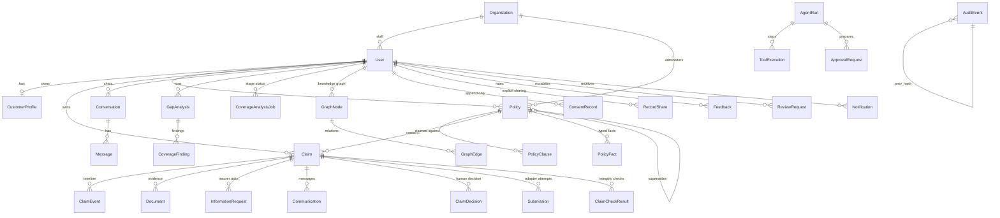

# Architecture

## 1. Overview

Lantern is a single deployable service: a FastAPI backend that serves a JSON API and the built React single page application, backed by a relational database, private file storage, JSON Lines operation logs and a hash chained audit log. The AI agent lives inside the backend as a tool using orchestrator; the model never has direct access to data.

```mermaid
flowchart LR
  subgraph Clients
    C[Customer app + PWA<br/>React, EN/中文]
    I[Insurer workspace<br/>React]
    B[Bank operations<br/>aggregates only]
  end
  subgraph API["FastAPI (backend/app)"]
    R[Routers<br/>auth · account · profile · policies · documents · gaps<br/>claims · communications · approvals · assistant · insurer · bank]
    A[Agent runner<br/>intent → prompt vN → provider loop → verifier → UI blocks]
    T[Typed tools<br/>tier 0 read · tier 1 prepare · tier 2 approval]
    P[Coverage pipeline<br/>facts → graph → A/B/C → verification A–F → calculator → prioritisation]
    S[Services<br/>retrieval · coverage · checklist · completeness · integrity ensemble<br/>claims lifecycle · approvals · claim pack · bank layer]
    AD[Insurer adapters<br/>mock (idempotent) · interface for real APIs]
    BA[Bank adapters<br/>8 interfaces · mocks, labelled]
  end
  subgraph Model["Model providers"]
    M1[Claude API<br/>assistant, consent gated]
    M2[Deterministic planner<br/>offline]
    M3[Open-weight A/B/C<br/>OpenAI compatible endpoints, in the bank's environment]
    M4[Rule based A/B/C<br/>offline fallback]
  end
  subgraph Data
    DB[(SQLAlchemy<br/>SQLite dev / Postgres)]
    F[(Private files<br/>uploads, packs)]
    L[(Operation logs<br/>JSONL per run)]
    AU[(Audit log<br/>hash chained)]
  end
  C -->|cookie session + CSRF| R
  I --> R
  B --> R
  R --> S
  R --> A
  R --> P
  A --> T
  T --> S
  T --> P
  A <--> M1
  A <--> M2
  P <--> M3
  P <--> M4
  S --> AD
  S --> BA
  P --> DB
  S --> DB
  S --> F
  A --> L
  S --> AU
  R --> AU
```

### Principles that shaped it
* **Deterministic business logic, probabilistic narration.** Coverage reading, checklists, completeness, gap findings, status transitions and approvals are rule based services with tests. The model (when present) chooses which tools to call and writes the explanation; it cannot change what the rules concluded.
* **Everything consequential goes through an approval.** Tier 2 tools create an `ApprovalRequest`; a backend service executes it only after the owner approves with a one time token bound to a hash of the payload shown on the card.
* **Same tools, two drivers.** The deterministic provider speaks the same tool protocol as the Claude API provider, so the whole stack runs and is tested offline, and the API path adds conversational quality without adding privilege.

## 2. Components

| Layer | Module | Responsibility |
|---|---|---|
| Identity | `security.py`, `deps.py` | argon2id passwords, server side sessions (hashed tokens, user agent, MFA flag), CSRF double submit, rate limiter, login lockout, hashed single use reset tokens, RFC 6238 TOTP, seven permission tiers and role dependencies, record scoping helpers (`customer_claim_or_404(permission=...)` honours explicit shares) |
| Documents | `services/extraction.py`, `routers/documents.py` | magic byte validation, size limits, text extraction (pypdf / UTF-8), prompt injection scan (EN/中文 patterns, hidden characters), clause segmentation and classification for uploaded wordings |
| Retrieval | `services/retrieval.py` | bilingual BM25 index per request over the caller's clauses; shared tag lexicon; silence detection; insurance type boost |
| Insurance rules | `services/taxonomy.py`, `coverage.py`, `checklist.py`, `completeness.py`, `gap_engine.py` | incident types and dynamic questions; clause grouping into cover / exclusions / conditions / financial terms with a conservative verdict; checklist items cross referenced to the policy's claims conditions; administrative completeness and conflicts; needs → findings with evidence |
| Claims | `services/claims.py`, `approvals.py`, `claim_pack.py`, `adapters/` | lifecycle state machine with role scoped transitions, events, approval preparation and execution, pack generation (JSON + PDF), insurer adapter interface and mock |
| Agent | `agent/tools.py`, `runner.py`, `intent.py`, `prompts.py`, `verifier.py`, `oplog.py`, `providers/` | tool registry with Pydantic schemas and tiers, run loop, intent classification, versioned prompts, citation verification, operation logs, providers |
| Coverage intelligence | `services/facts.py`, `graph.py`, `agent/analysts.py`, `services/verification.py`, `calculator.py`, `prioritisation.py`, `analysis.py` | typed policy fact extraction with status (known / unknown / not_found / ambiguous / conflicting), knowledge graph with provenance, three role analysis (A analyst, B challenger, C judge) with rule based and open-weight implementations, verification layers A to F, deterministic payout calculator with traces, transparent prioritisation, nine stage job runner with persisted status |
| Integrity | `services/integrity.py` | seven document and claim integrity checkers, explicit aggregation order, audience filtering, submission gates (only `failed_validation` blocks), handler escalation |
| Bank layer | `services/bank.py`, `routers/bank.py`, `routers/account.py` | eight provider agnostic interfaces with labelled mock adapters, consent purposes and append only consent records, explicit record sharing, aggregate analytics with k anonymity suppression, integration health, bank audit view |
| Insurer | `routers/insurer.py` | dashboard metrics with definitions, queue, workspace, assignment, status, information requests, decisions, notes, customers, team, audit |
| Frontend | `frontend/src` | customer app (overview, assistant, policies, analysis workspace with stage panel, finding cards and interactive risk graph, claims wizard and case page with camera capture, documents, messages, settings with consent, sharing and security panels), insurer workspace (dashboard, queue, case with integrity panel, customers, team/audit, account security), bank operations (aggregates, integration, audit, account security); ClaimMate design tokens, system font stack, bottom navigation under 900 px, installable PWA shell (service worker caches static assets only, never `/api`) |

## 3. Data model

Public identifiers are UUID4 strings. Every customer record carries `user_id`; policies and claims also carry `insurer_org_id`, the tenant key for the insurer side.



Key fields:
* `PolicyClause`: `clause_ref`, `section`, `title`, `text`, `kind` (coverage / exclusion / condition / limit / definition / claims_procedure), `tags` (shared vocabulary), `amount`, `language`, `translations`, `confidence` (1.0 for seeded wordings, 0.65 for extracted ones until the customer corrects them). The citation is `policy_number §clause_ref`.
* `Claim`: incident facts, `status` + `status_source` + `status_updated_at` (so the UI can say *last known status from X at T*), `checklist`, `completeness`, `coverage_view` snapshots (recomputed on every change), `assigned_handler_id`, `insurer_reference`, `submitted_at`, `first_response_at`.
* `ApprovalRequest`: `action_type`, `payload`, `payload_hash`, `token_hash`, `expires_at`, `status` (pending → approved → consumed | failed, or rejected | expired), `result`.
* `AuditEvent`: `seq`, `prev_hash`, `hash` over a canonical serialisation; `audit.verify_chain` recomputes the chain.
* `PolicyFact`: `fact_type` (excess, limit, sub_limit, waiting_period, notification_deadline, territorial_scope, exclusion …), typed `value` and `unit`, `status` (known / unknown / not_found / ambiguous / conflicting), `clause_id` and `excerpt` (the evidence), `extractor` and `extractor_version`, `confidence`. A fact never exists without a clause behind it.
* `Policy.version`, `supersedes_policy_id`, `endorsements`: a renewal is a new policy version; the graph keeps both and findings say which version they read.
* `GraphNode` / `GraphEdge`: typed nodes (customer, asset, need, policy, coverage_module, exclusion, limit, condition, definition, endorsement, finding …) and relations with `provenance` (`stated` by the customer or `inferred` by the pipeline, with the clause or fact it came from) and a `verified` flag.
* `CoverageAnalysisJob`: `stages` (nine, with status, timings and detail), `mode` (deterministic / models / mixed), `models` (per role: provider, model id, fallback flag, error), `pipeline_version`.
* `ClaimCheckResult`: per checker `status` (passed / warning / failed_validation / inconclusive / human_review_required), `audience` (customer / insurer), `inputs_hash`; the submission approval payload is bound to the hash.
* `ConsentRecord`: append only decisions per purpose with `source` (default / customer / seed) and timestamp; the current state is the latest row per purpose.
* `RecordShare`: owner, grantee, record type and id, `permissions` (view, optionally upload), `revoked_at`.
* `UserSession.mfa_passed`, `User.mfa_secret`, `LoginAttempt`, `PasswordResetToken`: account security state.

## 4. Core algorithms

### 4.1 Bilingual clause retrieval
1. Tokenise: English words are lower cased, stop words removed, folded through a synonym map (`stolen → theft`, `bikes → bike`) and lightly stemmed; Chinese runs become character bigrams (unigrams are indexed in documents only, so queries longer than one character do not match on incidental characters). A stop character list removes 的, 了, 是 … from both.
2. Tag: a bilingual lexicon maps words and phrases in either language to the canonical tag vocabulary (`被盗 → theft`, `charging → battery, charging`, `美国 → usa`). Tags are indexed as pseudo tokens with double weight, which is what makes cross lingual matches work.
3. Score with BM25 (k1 1.5, b 0.75) over `title + section + text + tags + kind`; boost ×1.5 for policies whose type the question names ("my e-bike policy").
4. Silence check: the best hit must share a tag or a non generic content term with the question, otherwise the answer is a refusal.

### 4.2 Coverage reading (never a decision)
For an incident type and description, derive peril tags (from the incident type and the description) and subject tags (bicycle, phone, vehicle …). Coverage clauses that share a peril tag "appear to cover"; exclusions that share any tag "may be relevant"; conditions and claims procedures are "conditions to meet"; limit clauses give the excess. If the description names a subject that no clause of the policy mentions, the verdict is `unclear_subject` (wrong policy for that item). Policies are ranked for an incident by verdict, clause count, subject hits and type affinity. The summary text always says "appears to include … subject to the terms and exclusions" and names the insurer as the decider.

### 4.3 Checklist from the policy's own conditions
Base items come from the incident type (photos, proof of ownership, police report, repair estimate, medical documents …). Then every `claims_procedure` and `condition` clause of the policy is scanned for tags (`police_report`, `receipt_required`, `estimates`, `time_limit`, `imei`, `vet_history` …); matching items are upgraded to *required* and carry a citation to the clause. Items are satisfied by documents keyed to them, by filled fields or by recorded actions.

### 4.4 Completeness (administrative only)
Mandatory fields, required documents, outstanding actions and information, conflicts (incident outside the policy period, future date, estimate far from the item total, duplicate uploads by hash, unreadable files, safety concern). Returns progress, `ready`, and a note that completeness is not a coverage view.

### 4.5 Gap engine
Profile → needs (buildings, contents, tenant liability, motor liability, e-bike liability/theft/rider accident, bicycle, laptop at home / away / for business, phone, valuables, pet vet fees / liability, travel medical / USA scope / duplicates, battery charging fire, dependants note). Each need looks for active coverage clauses with the right tags, checks stated limits against declared values, looks for exclusions and not selected extensions, and emits a finding with status, severity, explanation (EN/中文), suggested action and clause evidence.

### 4.6 Agent run
```
classify intent (rules) → build system prompt (versioned) with a short, non sensitive context
→ loop ≤ 8: provider.complete(system, history, tool schemas)
     tool_use → tools.execute(ctx, name, args): validate (Pydantic) → authorise (role, surface, tier) → run → record (masked) → oplog
     tier 2 → ApprovalRequest created, result "approval_required" (nothing executed)
→ final text → verifier: citations must be in ctx.retrieved_citations; unknown → "unverified"; coverage claim with no citation → caution banner
→ UI blocks (citations, checklist, coverage view, gap findings, approval card, draft) → persist message, run, tool executions → audit event
```
The deterministic provider receives the same tool results and plans a fixed script per intent (`policy_question: search → compose`, `claim_start: assess → create draft → compose`, …). If the Claude API fails, the runner switches to it for the rest of the run and records `provider_fallback` in the log.

### 4.7 Approvals
`prepare` computes a payload (incident facts, document ids and hashes, recipient, cover letter hash), stores its SHA-256 and a random token (only the token's hash is stored), expires in 15 minutes, and moves the claim to *awaiting customer approval*. `decide` checks owner, status, expiry, token, then recomputes the payload hash from the live claim: if anything changed since the card was shown, execution is refused. Execution runs the adapter with an idempotency key `claim:<id>:approval:<id>`; the adapter replays the same result for a repeated key. A second approval of the same card is rejected; preparing a new card expires the old one.

### 4.8 Coverage intelligence pipeline
Nine persisted stages, each with status, timings and a detail record the workspace shows live:
```
customer_context → extraction → graph → analysts → challenge → judge → verification → calculation → report
```
* **Extraction** turns every clause into typed `PolicyFact`s with an explicit status. A figure that the wording does not contain is `not_found`, never guessed; two clauses that give different values for the same fact are `conflicting` and surface in the report.
* **Graph** writes nodes and edges with provenance and keeps policy versions apart.
* **Analysts.** A (primary) and B (challenger) each receive the same minimal evidence package (facts with clause ids and capped excerpts, stated circumstances; no email, no document bodies). B produces its own assessment first and only then sees A's, so challenges are independent. C (judge) receives A, B, the challenges and the deterministic verification results and must give a verdict per finding (accepted / rejected / revise / unresolved) with a reason that names clauses or checks. Each role has a rule based implementation and an OpenAI compatible model implementation (`docs/MODELS.md`); the chosen mode and every fallback are recorded on the job.
* **Verification layers.** A source exists and belongs to the caller; B evidence support (tags of the cited clause against the need); C contradictions between cited clauses; D rule consistency (money and duration figures in the statement must match a fact or a calculator output); E independent check (B's or C's agreement, or `pending`); F escalation to a human when the layers disagree or the judge returns `unresolved`.
* **Calculator.** `CoverageRule`s (`limit_then_excess`, `excess_then_limit`, `proportion`; anything else is `unsupported`) with optional sub limits and percentages are validated before use; outputs carry a step by step trace, the rule version and the inputs, and are labelled illustrative. No rule, no number.
* **Prioritisation.** `risk_priority` = severity + status + uncovered value over 1,000 + stated concern + time sensitivity + legal requirement, with published weights and thresholds (`prioritisation.WEIGHTS`), kept separate from `evidence_confidence` (the verification result). A finding can be critical to investigate and weakly evidenced at the same time, and the card says both.

### 4.9 Integrity ensemble
Seven checkers run on every claim change: dates, document integrity, duplicate evidence, amount plausibility, prompt injection, cross document consistency, evidence provenance. Each returns `passed`, `warning`, `failed_validation`, `inconclusive` or `human_review_required`, with a plain language reason and an audience. Aggregation is a fixed order (`failed_validation` > `human_review_required` > `warning` > `inconclusive` > `passed`); warnings never become failures. Only `failed_validation` blocks a submission; `human_review_required` sends the claim to an insurer reviewer with the customer informed in neutral terms. The system never accuses: wording is "needs a second look", never "fraud".

### 4.10 Consent aware model routing
The assistant runner checks the customer's `external_model_processing` consent before contacting a hosted provider; without it the deterministic planner runs and the plan records a `consent` step. The coverage pipeline's open-weight models run on endpoints inside the bank's environment, so they are not external processing.

### 4.11 Bank integration layer
`services/bank.py` defines eight `Protocol` interfaces (identity provider, customer profile source, consent manager, document source, communications channel, audit sink, analytics sink, embedding context). The only implementation in this repository is `MockAdapters`, whose results all carry `mock=True`, which logs every call and which `integration_health` reports as mode `mock`. Consent decisions are mirrored to the mock consent manager; the bank dashboard publishes its aggregate (and nothing else) to the mock analytics sink. Replacing a mock means registering a real implementation in `adapters_for()`; no router changes. The bank administrator role can read aggregates (k anonymity 3), integration health and the bank's own audit trail, and has no route to identifiable customer records (`/api/bank/customers/{id}` returns 403 by design).

## 5. Insurer analytics
Every metric on the dashboard is computed live from the claims of the signed in organisation with a definition string, so the interface can show what it means. Amounts are reported separately as submitted (customer estimates), approved (decisions), settled (approved amounts on settled claims) and outstanding (approved not settled), never summed into one figure.

## 6. Frontend delivery
The frontend is a Vite built single page application served by FastAPI. One locale is authoritative: the UI language is sent as `X-Lang` on every request, the server resolves `Principal.lang` from it and localises every payload it generates, and pages refetch when the language changes. Navigation keeps URL, content and active state in sync (route params for subsections, `ScrollToTop`, `document.title`). Under 900 px the sidebar becomes a bottom navigation with a "More" sheet; camera capture uses `<input capture="environment">`. The service worker caches only the static shell and never `/api`, so no private data is cached on the device.

## 7. Extending to production
* Replace SQLite with Postgres by changing `DATABASE_URL`; the schema uses portable types (JSON, UUID strings).
* Replace `MockInsurerAdapter` with a real adapter implementing `InsurerAdapter` (`submit_claim`, `get_claim_status`, `verify_webhook`) and select it per organisation in `get_adapter`.
* Move the rate limiter and session store to Redis for multi process deployments.
* Add OCR for image only PDFs behind `extract_text`; add an embedding re-ranker behind `ClauseIndex.search` if lexical recall proves insufficient (the citation and verification pipeline is unchanged).
