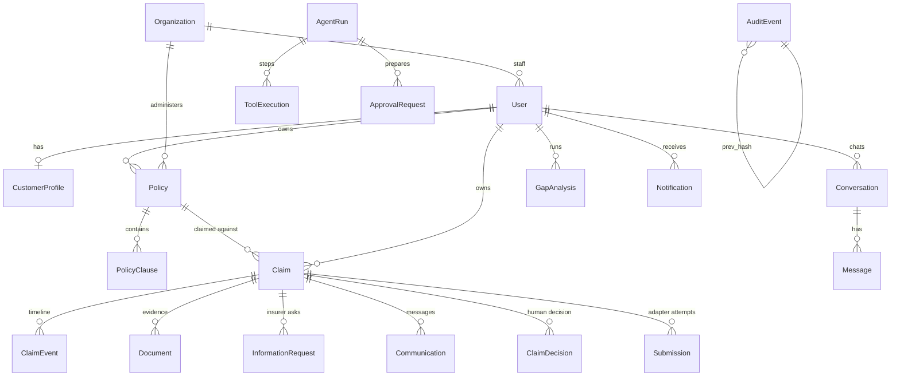

# Architecture

## 1. Overview

Lantern is a single deployable service: a FastAPI backend that serves a JSON API and the built React single page application, backed by a relational database, private file storage, JSON Lines operation logs and a hash chained audit log. The AI agent lives inside the backend as a tool using orchestrator; the model never has direct access to data.

```mermaid
flowchart LR
  subgraph Clients
    C[Customer app<br/>React, EN/中文]
    I[Insurer workspace<br/>React]
  end
  subgraph API["FastAPI (backend/app)"]
    R[Routers<br/>auth · profile · policies · documents · gaps<br/>claims · communications · approvals · assistant · insurer]
    A[Agent runner<br/>intent → prompt vN → provider loop → verifier → UI blocks]
    T[Typed tools<br/>tier 0 read · tier 1 prepare · tier 2 approval]
    S[Services<br/>retrieval · coverage · checklist · completeness<br/>gap engine · claims lifecycle · approvals · claim pack]
    AD[Insurer adapters<br/>mock (idempotent) · interface for real APIs]
  end
  subgraph Model["Model provider"]
    M1[Claude API<br/>tool use]
    M2[Deterministic planner<br/>offline]
  end
  subgraph Data
    DB[(SQLAlchemy<br/>SQLite dev / Postgres)]
    F[(Private files<br/>uploads, packs)]
    L[(Operation logs<br/>JSONL per run)]
    AU[(Audit log<br/>hash chained)]
  end
  C -->|cookie session + CSRF| R
  I --> R
  R --> S
  R --> A
  A --> T
  T --> S
  A <--> M1
  A <--> M2
  S --> AD
  S --> DB
  S --> F
  A --> L
  S --> AU
  R --> AU
```

### Principles that shaped it
* **Deterministic business logic, probabilistic narration.** Coverage reading, checklists, completeness, gap findings, status transitions and approvals are rule based services with tests. The model (when present) chooses which tools to call and writes the explanation; it cannot change what the rules concluded.
* **Everything consequential goes through an approval.** Tier 2 tools create an `ApprovalRequest`; a backend service executes it only after the owner approves with a one time token bound to a hash of the payload shown on the card.
* **Same tools, two drivers.** The deterministic provider speaks the same tool protocol as the Claude API provider, so the whole stack runs and is tested offline, and the API path adds conversational quality without adding privilege.

## 2. Components

| Layer | Module | Responsibility |
|---|---|---|
| Identity | `security.py`, `deps.py` | argon2 passwords, server side sessions (hashed tokens), CSRF double submit, rate limiter, role dependencies, record scoping helpers (`customer_claim_or_404`, `insurer_claim_or_404`) |
| Documents | `services/extraction.py`, `routers/documents.py` | magic byte validation, size limits, text extraction (pypdf / UTF-8), prompt injection scan (EN/中文 patterns, hidden characters), clause segmentation and classification for uploaded wordings |
| Retrieval | `services/retrieval.py` | bilingual BM25 index per request over the caller's clauses; shared tag lexicon; silence detection; insurance type boost |
| Insurance rules | `services/taxonomy.py`, `coverage.py`, `checklist.py`, `completeness.py`, `gap_engine.py` | incident types and dynamic questions; clause grouping into cover / exclusions / conditions / financial terms with a conservative verdict; checklist items cross referenced to the policy's claims conditions; administrative completeness and conflicts; needs → findings with evidence |
| Claims | `services/claims.py`, `approvals.py`, `claim_pack.py`, `adapters/` | lifecycle state machine with role scoped transitions, events, approval preparation and execution, pack generation (JSON + PDF), insurer adapter interface and mock |
| Agent | `agent/tools.py`, `runner.py`, `intent.py`, `prompts.py`, `verifier.py`, `oplog.py`, `providers/` | tool registry with Pydantic schemas and tiers, run loop, intent classification, versioned prompts, citation verification, operation logs, providers |
| Insurer | `routers/insurer.py` | dashboard metrics with definitions, queue, workspace, assignment, status, information requests, decisions, notes, customers, team, audit |
| Frontend | `frontend/src` | customer app (overview, assistant, policies, gaps, claims wizard and case page, documents, messages, settings) and insurer workspace (dashboard, queue, case, customers, team/audit), bilingual UI, citation chips with clause drawer, approval cards, transparency panel |

## 3. Data model

Public identifiers are UUID4 strings. Every customer record carries `user_id`; policies and claims also carry `insurer_org_id`, the tenant key for the insurer side.



Key fields:
* `PolicyClause`: `clause_ref`, `section`, `title`, `text`, `kind` (coverage / exclusion / condition / limit / definition / claims_procedure), `tags` (shared vocabulary), `amount`, `language`, `translations`, `confidence` (1.0 for seeded wordings, 0.65 for extracted ones until the customer corrects them). The citation is `policy_number §clause_ref`.
* `Claim`: incident facts, `status` + `status_source` + `status_updated_at` (so the UI can say *last known status from X at T*), `checklist`, `completeness`, `coverage_view` snapshots (recomputed on every change), `assigned_handler_id`, `insurer_reference`, `submitted_at`, `first_response_at`.
* `ApprovalRequest`: `action_type`, `payload`, `payload_hash`, `token_hash`, `expires_at`, `status` (pending → approved → consumed | failed, or rejected | expired), `result`.
* `AuditEvent`: `seq`, `prev_hash`, `hash` over a canonical serialisation; `audit.verify_chain` recomputes the chain.

## 4. Core algorithms

### 4.1 Bilingual clause retrieval
1. Tokenise: English words are lower cased, stop words removed, folded through a synonym map (`stolen → theft`, `bikes → bike`) and lightly stemmed; Chinese runs become character bigrams (unigrams are indexed in documents only, so queries longer than one character do not match on incidental characters). A stop character list removes 的, 了, 是 … from both.
2. Tag: a bilingual lexicon maps words and phrases in either language to the canonical tag vocabulary (`被盗 → theft`, `charging → battery, charging`, `美国 → usa`). Tags are indexed as pseudo tokens with double weight, which is what makes cross lingual matches work.
3. Score with BM25 (k1 1.5, b 0.75) over `title + section + text + tags + kind`; boost ×1.5 for policies whose type the question names ("my e-bike policy").
4. Silence check: the best hit must share a tag or a non generic content term with the question, otherwise the answer is a refusal.

### 4.2 Coverage reading (never a decision)
For an incident type and description, derive peril tags (from the incident type and the description) and subject tags (bicycle, phone, vehicle …). Coverage clauses that share a peril tag "appear to cover"; exclusions that share any tag "may be relevant"; conditions and claims procedures are "conditions to meet"; limit clauses give the excess. If the description names a subject that no clause of the policy mentions, the verdict is `unclear_subject` (wrong policy for that item). Policies are ranked for an incident by verdict, clause count, subject hits and type affinity. The summary text always says "appears to include … subject to the terms and exclusions" and names the insurer as the decider.

### 4.3 Checklist from the policy's own conditions
Base items come from the incident type (photos, proof of ownership, police report, repair estimate, medical documents …). Then every `claims_procedure` and `condition` clause of the policy is scanned for tags (`police_report`, `receipt_required`, `estimates`, `time_limit`, `imei`, `vet_history` …); matching items are upgraded to *required* and carry a citation to the clause. Items are satisfied by documents keyed to them, by filled fields or by recorded actions.

### 4.4 Completeness (administrative only)
Mandatory fields, required documents, outstanding actions and information, conflicts (incident outside the policy period, future date, estimate far from the item total, duplicate uploads by hash, unreadable files, safety concern). Returns progress, `ready`, and a note that completeness is not a coverage view.

### 4.5 Gap engine
Profile → needs (buildings, contents, tenant liability, motor liability, e-bike liability/theft/rider accident, bicycle, laptop at home / away / for business, phone, valuables, pet vet fees / liability, travel medical / USA scope / duplicates, battery charging fire, dependants note). Each need looks for active coverage clauses with the right tags, checks stated limits against declared values, looks for exclusions and not selected extensions, and emits a finding with status, severity, explanation (EN/中文), suggested action and clause evidence.

### 4.6 Agent run
```
classify intent (rules) → build system prompt (versioned) with a short, non sensitive context
→ loop ≤ 8: provider.complete(system, history, tool schemas)
     tool_use → tools.execute(ctx, name, args): validate (Pydantic) → authorise (role, surface, tier) → run → record (masked) → oplog
     tier 2 → ApprovalRequest created, result "approval_required" (nothing executed)
→ final text → verifier: citations must be in ctx.retrieved_citations; unknown → "unverified"; coverage claim with no citation → caution banner
→ UI blocks (citations, checklist, coverage view, gap findings, approval card, draft) → persist message, run, tool executions → audit event
```
The deterministic provider receives the same tool results and plans a fixed script per intent (`policy_question: search → compose`, `claim_start: assess → create draft → compose`, …). If the Claude API fails, the runner switches to it for the rest of the run and records `provider_fallback` in the log.

### 4.7 Approvals
`prepare` computes a payload (incident facts, document ids and hashes, recipient, cover letter hash), stores its SHA-256 and a random token (only the token's hash is stored), expires in 15 minutes, and moves the claim to *awaiting customer approval*. `decide` checks owner, status, expiry, token, then recomputes the payload hash from the live claim: if anything changed since the card was shown, execution is refused. Execution runs the adapter with an idempotency key `claim:<id>:approval:<id>`; the adapter replays the same result for a repeated key. A second approval of the same card is rejected; preparing a new card expires the old one.

## 5. Insurer analytics
Every metric on the dashboard is computed live from the claims of the signed in organisation with a definition string, so the interface can show what it means. Amounts are reported separately as submitted (customer estimates), approved (decisions), settled (approved amounts on settled claims) and outstanding (approved not settled), never summed into one figure.

## 6. Extending to production
* Replace SQLite with Postgres by changing `DATABASE_URL`; the schema uses portable types (JSON, UUID strings).
* Replace `MockInsurerAdapter` with a real adapter implementing `InsurerAdapter` (`submit_claim`, `get_claim_status`, `verify_webhook`) and select it per organisation in `get_adapter`.
* Move the rate limiter and session store to Redis for multi process deployments.
* Add OCR for image only PDFs behind `extract_text`; add an embedding re-ranker behind `ClauseIndex.search` if lexical recall proves insufficient (the citation and verification pipeline is unchanged).
